  

# Daniel Rodrigues
**UX/UI Designer · Front-End Developer · Creative Technologist**

*Design · Code · Motion · AI*  
*Digital interfaces designed with intention, built with code, and extended through creative AI.*

### 💬 Let's connect

*Open to UX/UI Design, Front-End Development and international opportunities.*

## About
I design and build responsive digital interfaces, combining front-end development with visual communication, storytelling and AI-assisted creative workflows. My background spans web development, audiovisual production, motion design and journalism.

**Based in Brazil · Open to remote work and international relocation.**

## AI Skills & Creative Engineering
| Project | Description |
|---|---|
| [DesignerX](https://github.com/iwerry/designerx) | Agent-based UX/UI critique, design systems, accessibility and engineering handoff. |
| [Daniskills 3.3](https://github.com/iwerry/Daniskills) | Cinematic AI production architecture, continuity, prompting and quality assurance; successor to CineOS. |
| [code2video — AI Motion Director](https://github.com/iwerry/code2video) | Code-driven motion graphics with Canvas-to-MP4 rendering, audio and QA. |
| [LinkedIn Profile Optimizer](https://github.com/iwerry/linkedin-skills-pro) | LinkedIn headline, experience and skills optimization. |
| [skill-master-scene](https://github.com/iwerry/skill-master-scene) | Master Scene screenplay formatting and validation. |

## Digital Products & Live Sites
| Project | Live Demo | Focus |
|---|---|---|
| Brasil Mostra Japão | [Website](https://brasilmostrajapao.com.br) | Cultural event platform |
| Entre Elas | [Website](https://www.projetoentreelas.com.br) | Professional training and social impact |
| Foto Cidade DF | [Website](https://fotocidadedf.com.br) | Photography and territorial communication |
| Photography 60+ | [Website](https://fotografiabsb.vercel.app) | Eight-week course created and taught by Daniel Rodrigues |
| Personal Portfolio | [Website](https://iwerry.github.io/danielrodrigues-cv.in/) | Interactive multilingual web experience |

**Source:** [BMJ2026](https://github.com/iwerry/BMJ2026) · [EntreElas](https://github.com/iwerry/EntreElas) · [Foto Cidade DF](https://github.com/iwerry/Foto-Cidade-DF) · [Photography 60+](https://github.com/iwerry/curso-fotografia-60mais-ptbr)

## Skills
**Front-End:** HTML5 · CSS3 · JavaScript · TypeScript · React · Next.js · Tailwind CSS

**UX/UI:** Responsive Design · Figma · Penpot · Prototyping · UX Research · Design Systems

**Creative Technology:** Generative AI · Motion Design · 3D · Photography · Video · Visual Storytelling

**Additional Background:** CMS · WordPress · Drupal · PHP/MySQL · GNU/Linux · Journalism & OSINT

## Professional Experience
**Draft Creative Studio (2016–present)** — UX/UI design, responsive websites and front-end implementation, with creative technology, motion and AI workflows supporting digital experiences.

**Web Design & Technical Systems (2002–2015)** — Web design, CMS development, WordPress, Drupal, PHP, MySQL and GNU/Linux environments.

**Credentials:** Registered Journalist (Brazil), DRT Nº 0016639/DF. AI training in progress through Claude Academy (Anthropic) and OpenAI Academy.

## Education & Languages
**Audiovisual & Filmmaking — Undergraduate Studies (not completed)**, Universidade Uninabuco Digital · 2021–2023

Portuguese — Native · Spanish — C1 · English — B1  
[View certificates](https://drive.google.com/drive/folders/1CzAd2TRzlszizv5Tpz7VWMGog4B78gaL?usp=sharing)

## Contact
[Email](mailto:draftcs21@gmail.com) · [LinkedIn](https://www.linkedin.com/in/daniel-rodrigues-ux/) · [Portfolio](https://iwerry.github.io/danielrodrigues-cv.in/)
